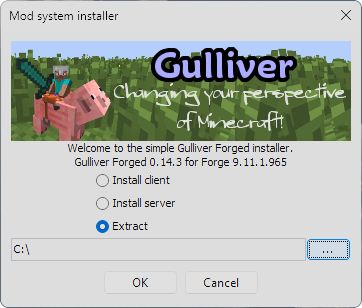
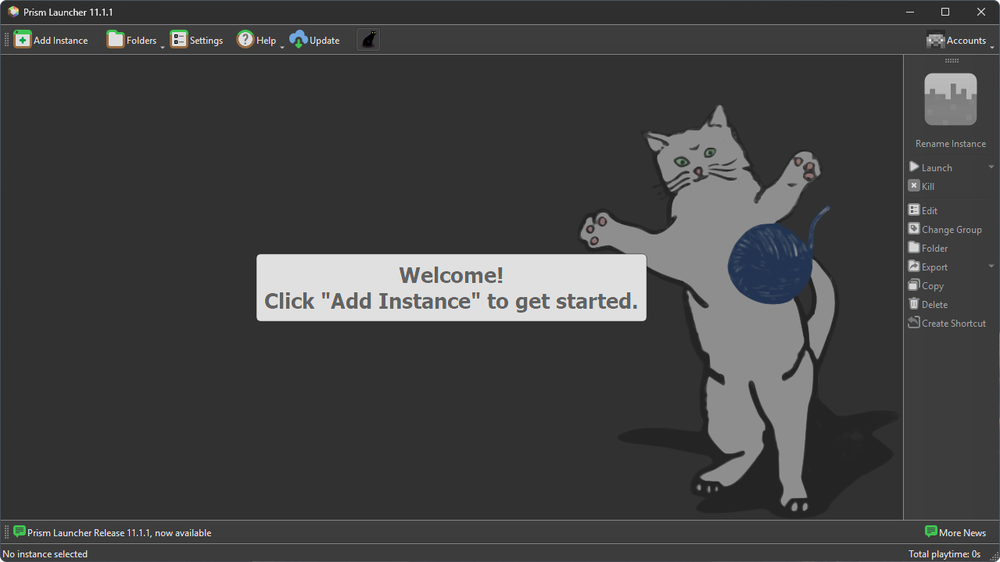
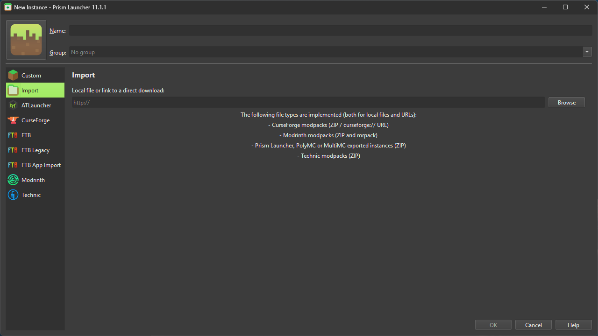
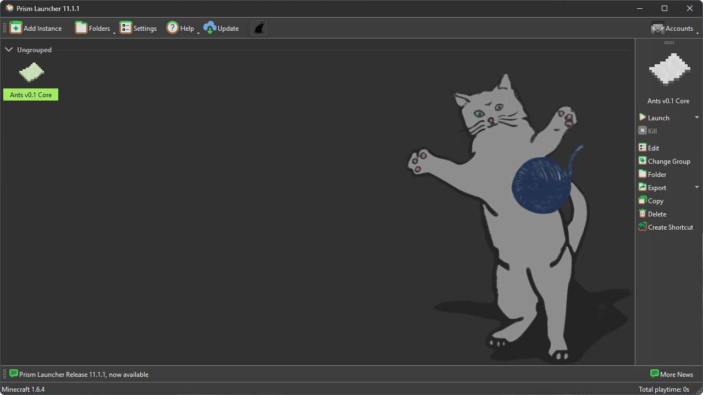
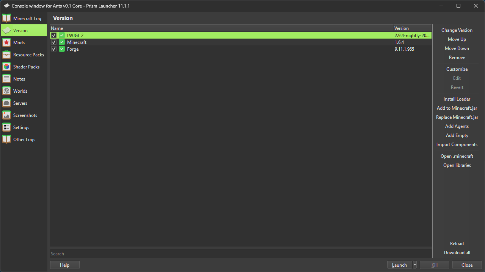
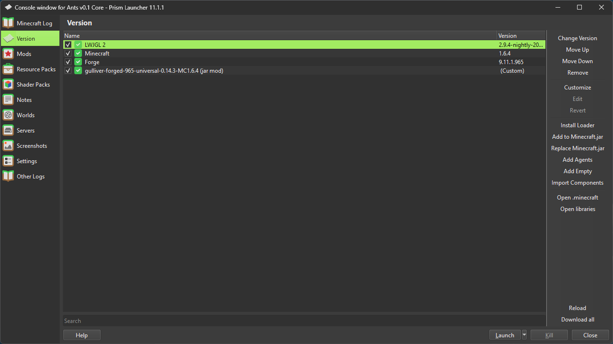

# ANTS 

Minecraft modpack based on Mr.Freeze's "ANTS" series.

> [!IMPORTANT]
> A fan-made, non-commercial Minecraft modpack. Currently in alpha.

**This project is unofficial. I am not MrFreeze and I am not affiliated with him in any way.**
## Project Status
- Fan-made
- Non-commercial
- Alpha stage
- Original idea by MrFreeze

## Releases

No releases yet.

## Installation

> Works only with Prism Launcher, MultiMC and their forks.

<b>Step 1. Download Gulliver Mod</b>

Gulliver Mod is not included in the pack because of its license, so you download it from the author's link.

1. Download the installer: [gulliver-forged-965-installer-0.14.3-MC1.6.4.jar](https://www.mediafire.com/download/74rm7ekaazvdime/gulliver-forged-965-installer-0.14.3-MC1.6.4.jar)
2. Double-click the file.
3. In the window that appears, choose **Extract** (not Install client or Install server) and pick any folder. Remember where you saved it.

<b>Step 2. Import the pack</b>

  

1. Launch Prism Launcher.

 

  

 

2. Click **Add Instance**.

 

  

 

3. Open the **Import** tab.
4. Click **Browse** and select the pack archive (Ants v0.1 Core, or Ants v0.1 Core E4MC-RETRO).
5. Click **OK**.

 

  

 

<b>Step 3. Install Gulliver Mod</b>

1. Select the new instance and click **Edit** in the side panel.
2. Open the **Version** tab.

 

  

 

3. Click **Add to Minecraft.jar**.
4. Select `gulliver-forged-965-universal-0.14.3-MC1.6.4` from the folder you chose in Step 1.

 

  

 

Do not put it in the `mods` folder.

Done. Launch the instance and play.

## Mods Used

Where a mod is not available on CurseForge, the link leads to another source (Modrinth, GitHub or an archived forum thread).

| Mod | Version |
| --- | --- |
| [AtomicStryker Update Check Mod](https://openeye.openmods.info/mod/as_updatecheck/1.1.1) | 1.1.1 |
| [bspkrsCore](https://www.curseforge.com/minecraft/mc-mods/bspkrscore) | 9.1.11.953 |
| [CodeChickenCore](https://modrinth.com/mod/codechicken-core) | 0.9.0.9 |
| [CodeChickenLib](https://github.com/Chicken-Bones/CodeChickenLib) | 1.0.0.62 |
| [DrZhark's CustomSpawner](https://openeye.openmods.info/mod/customspawner/3.0.0) | 3.0.0 |
| [DrZhark's Mo'Creatures Mod](https://www.curseforge.com/minecraft/mc-mods/mo-creatures) | 6.1.0 |
| [Dynamic Lights](https://www.curseforge.com/minecraft/mc-mods/dynamic-lights) | 1.2.8 |
| [Gulliver Mod](https://www.minecraftforum.net/forums/mapping-and-modding-java-edition/minecraft-mods/1282337-mc-forge-1-6-4-gulliver-the-resizing-mod-v0-14-3#download) | 0.14.3 |
| [Insta House](https://www.minecraftforum.net/forums/mapping-and-modding-java-edition/minecraft-mods/1284919-insta-house-mod-v-8-0-full-completely-updated) | 5.3 |
| [Legacy Java Fixer](https://www.curseforge.com/minecraft/mc-mods/legacy-java-fixer) | 1.0 |
| [Little Blocks](https://www.minecraftforum.net/forums/mapping-and-modding-java-edition/minecraft-mods/1282337-mc-forge-1-6-4-gulliver-the-resizing-mod-v0-14-3) | 2.2.4.1 |
| [Lucky Block](https://www.curseforge.com/minecraft/mc-mods/lucky-block) | 4.2.1 |
| [StartingInventory](https://www.curseforge.com/minecraft/mc-mods/startinginventory) | 9.11.1.932 |
| [NotEnoughItems](https://www.curseforge.com/minecraft/mc-mods/notenoughitems) | 1.6.1.9 |
| [Slimevoid Library](https://github.com/SlimeVoid/SlimevoidLibrary) | 2.1.0.0 |
| [ZoomMod](https://www.curseforge.com/minecraft/mc-mods/zoommod) | 1.2 |

All mods listed above belong to their respective authors.

## Wiki

The GitHub wiki is a work in progress.

## Official Links

None yet.
